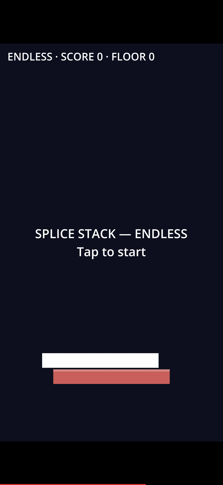
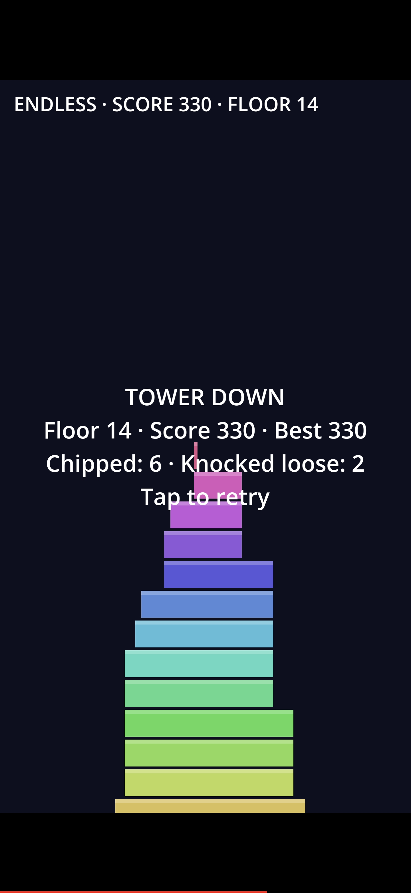

# Splice Stack

## TL;DR
A one-tap stacking game for Android: drop the sliding block, the overhang gets sliced off — and falling slices can chip or knock loose blocks from your own tower. PERFECT drops build streaks, Daily Tower gives everyone the same tower pattern each day. Built in Godot 4, MIT, offline, local scores only.

## How to play
- **Tap** to drop the sliding block. Whatever overhangs the block below is sliced off and falls.
- Falling slices that land on an exposed ledge of your tower **chip** the block (grazing hit) or **knock it loose** (solid hit).
- Land dead-on for a **PERFECT** — streaks score more, and every 5th perfect restores some width.
- Land within a hair for a **CLOSE** bonus.
- Miss completely and the run ends.

Modes: **Endless** and **Daily Tower** (date-seeded spawn pattern, same for all players that day; your best daily floor is recorded). Keys `1` / `2` switch modes in desktop builds.

## Screenshots

Real captures from a phone running v1.0.4:

  
  

Left: the start screen. Right: the end of a run — a 14-floor tower (Score 330) that took 6 chips and 2 knocked-loose blocks along the way.

## Builds
- **Android APK:** built by CI (`.github/workflows/apk.yml`) on every push to `main` and uploaded as the `SpliceStack-apk` artifact. The APK is **debug-signed** — suitable for sideload testing, not a Play Store release build.
- **Web version:** the same game (full MVP, plus share card and settings screen) lives in `web/index.html` — open it in any browser.

## Development
- Godot 4.3 project. Open `project.godot` in Godot 4.3+.
- Logic harness (drives the real game headlessly — perfect-climb, knock-loose geometry, daily determinism): `godot --headless --path . -s tests/test_mvp.gd`
- Capability matrix vs the design spec, scored only from test evidence: `docs/PARITY.md`

## License
MIT — see `LICENSE`.
